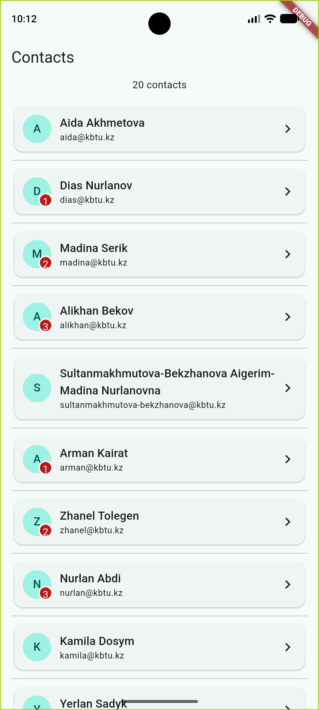
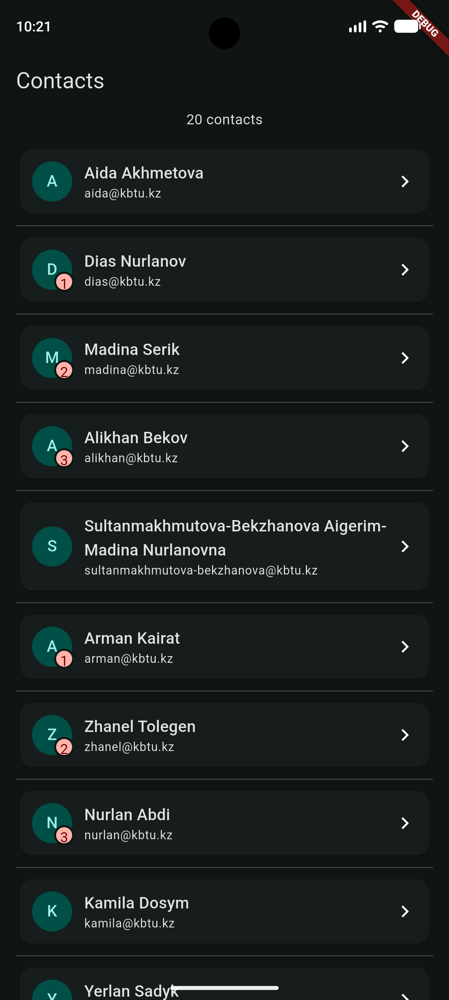
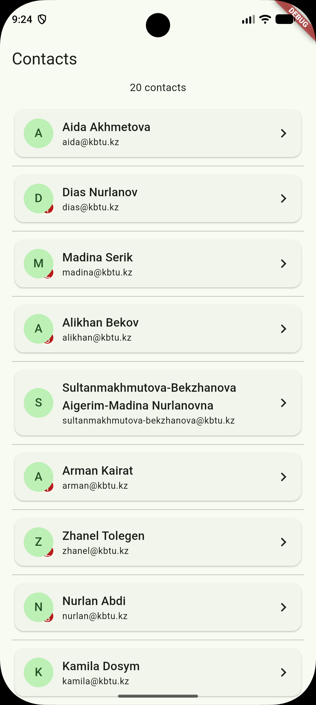

# Practice 5 — A Screen That Never Overflows

Экран с 20 контактами, переносом длинных имён и значками
непрочитанных сообщений. Поддерживает светлую и тёмную темы.

## Запуск

Из корня репозитория:

```powershell
flutter pub get
flutter run -t lib/week05/main.dart
```

## Проверка кода

```powershell
flutter analyze lib/week05
```

## Скриншоты

Светлая тема:


Тёмная тема:


Эксперимент с порядком слоёв:
