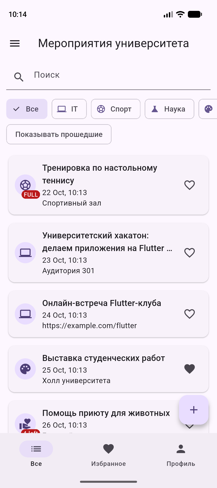
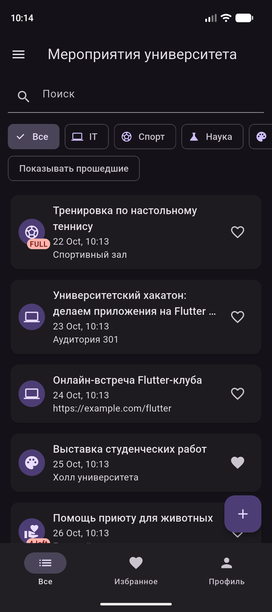
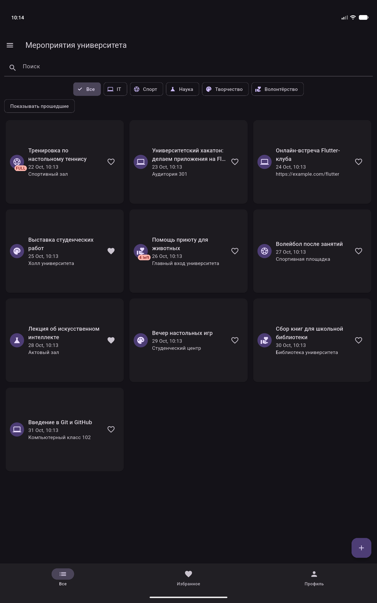

# Университетские мероприятия — Lab 1

Приложение для поиска мероприятий кампуса, записи на них и сохранения избранного.
Все данные хранятся в памяти: перезапуск возвращает начальные данные.
Сторонних пакетов приложения нет: Flutter SDK и flutter_lints.

## Возможности

- Три вкладки: все мероприятия, избранное, профиль.
- Поиск по названию, фильтр категории и показ прошедших событий.
- Список на телефоне; сетка при ширине от 600 px с ячейками не шире 360 px.
- Подробности с изображением, отсчётом, участниками и отметкой «Вы».
- Запись/отмена записи с подтверждением; при полном событии запись отключена.
- Создание, редактирование и удаление через типизированные маршруты.
- Проверки полей, дата/время, онлайн-ссылка, секундное сохранение и защита черновика.
- Светлая, тёмная и системная темы; Drawer с информацией и сбросом данных.

## Запуск

```powershell
cd labs/lab01
flutter pub get
flutter run
```

Проверки:

```powershell
flutter analyze
dart format --output=none --set-exit-if-changed .
flutter build apk --debug
```

Готовый debug APK: `build/app/outputs/flutter-apk/app-debug.apk`.
Поля профиля сохраняются нажатием Enter/Done на клавиатуре.

## Скриншоты

Из работающего Android-эмулятора; для сетки размер виртуального дисплея временно увеличен и затем восстановлен.

| Телефон, светлая тема | Телефон, тёмная тема |
| --- | --- |
|  |  |



## Decisions

Общий список мероприятий и профиль находятся в State оболочки ShellScreen, чтобы все вкладки работали с одними данными.
Экран подробностей получает модель и callbacks, потому что изменения участников и удаление должны обновлять список в оболочке.
Форма возвращает новый Event через Navigator.pop, поэтому выход без сохранения не изменяет исходный объект.
Сетка выбирается через LayoutBuilder, который измеряет доступную ширину виджета, а сортировка всегда работает с копией списка.
PopScope сравнивает значения всех полей с исходными, поэтому восстановление исходных значений делает форму чистой, а сохранение выходит без диалога.
Время окончания в модели отсутствует, поэтому принято правило длительности в один час, а Timer обновляет статус раз в минуту и отменяется в dispose.
С инструментами следующей темы я бы вынес состояние в отдельный слой и добавил постоянное хранение, сохранив неизменяемые модели и проверки формы.

## Структура

- `lib/models/` — модели, категории, состояния отсчёта.
- `lib/data/seed.dart` — 12 примеров, включая название из 60 символов, FULL, прошлое, онлайн и отсутствие описания.
- `lib/screens/` — оболочка, вкладки, подробности и форма.
- `lib/widget/` — карточка, список/сетка, шапка, пустое состояние.
- `lib/utils/format.dart` — собственное форматирование дат.
- `lib/routes.dart` — константы маршрутов и классы аргументов.
- `DEFENSE_GUIDE.md` — краткая памятка по функциям и передаче данных.

## Изображение

Файл `assets/campus_header.png` создан встроенным imagegen и включён в приложение для работы офлайн.
Запрос: «Иллюстрация современного университетского кампуса: двор, деревья, солнечный свет, небольшие группы студентов; спокойная композиция, без текста, логотипов и водяных знаков, свободное место для подписей в углах».

## Расположение в репозитории

Лабораторная находится в `labs/lab01` и запускается как самостоятельный Flutter-проект.
Предыдущие практические работы сохранены в корне репозитория.
История разработки не подменяется: текущая готовая версия добавлена отдельным содержательным коммитом.
